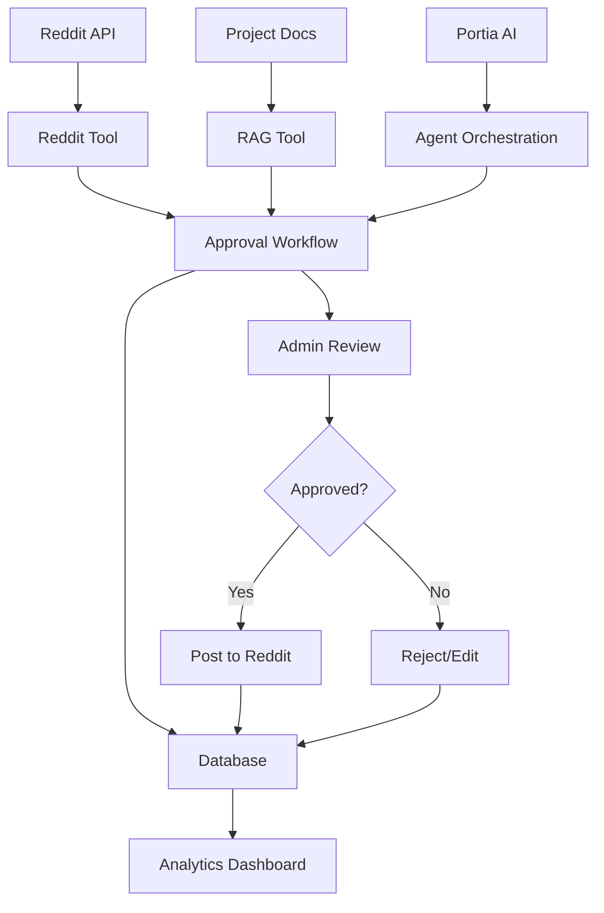

# OSS Community Auto-Responder 🤖

[](https://www.python.org/downloads/)
[](https://portia.ai)
[](LICENSE)
[]()

> An intelligent AI agent that helps open-source maintainers scale community support on Reddit while maintaining complete human oversight and control.

## 📋 Table of Contents

- [Overview](#-overview)
- [Features](#-features)
- [Architecture](#-architecture)
- [Quick Start](#-quick-start)
- [Installation](#-installation)
- [Configuration](#-configuration)
- [Usage](#-usage)
- [Project Structure](#-project-structure)
- [API Documentation](#-api-documentation)
- [Testing](#-testing)
- [Contributing](#-contributing)
- [Roadmap](#-roadmap)
- [Support](#-support)
- [License](#-license)

## 🎯 Overview

### The Problem

Open-source maintainers spend countless hours answering repetitive questions across forums like Reddit, Discord, and GitHub. This leads to:

- ⏰ **Time Drain**: Hours spent on repetitive support tasks
- 🔥 **Maintainer Burnout**: Exhaustion from constant community management
- ⏳ **Delayed Responses**: Community members wait longer for help
- 📉 **Reduced Development Time**: Less time for actual project development

### Our Solution

The OSS Community Auto-Responder is a **human-in-the-loop AI agent** that:

1. 🔍 **Monitors** Reddit for relevant questions about your project
2. 🧠 **Generates** intelligent responses using your project documentation
3. ⏸️ **Pauses** for human approval before posting anything
4. ✅ **Posts** only after maintainer review and approval
5. 📊 **Tracks** all activities with complete transparency

## ✨ Features

### 🤖 AI-Powered Intelligence

- **Portia AI Integration**: Modern agent orchestration framework
- **RAG System**: Retrieval-Augmented Generation using project documentation
- **Multi-LLM Support**: Groq, OpenAI, Ollama compatibility
- **Content Moderation**: Built-in safety and appropriateness checks

### 🛡️ Safety & Control

- **Human-in-the-Loop**: Mandatory admin approval for all responses
- **DRY_RUN Mode**: Safe testing without live posting
- **Content Filtering**: Automatic moderation and safety checks
- **Audit Trail**: Complete logging of all decisions and actions

### 🎛️ Management Interface

- **Streamlit Dashboard**: Professional web-based admin interface
- **Real-time Monitoring**: Live statistics and system health
- **Approval Queue**: Easy review and management of pending responses
- **Analytics**: Performance metrics and community engagement tracking

### 🔧 Technical Features

- **Rate Limiting**: Respects Reddit API limits automatically
- **Error Handling**: Comprehensive error recovery and resilience
- **Database Persistence**: SQLite-based request and response tracking
- **Configuration Management**: Environment-based settings

## 🏗️ Architecture



### Core Components

- **Agent Layer**: Portia AI orchestration and workflow management
- **Tool Ecosystem**: Reddit integration, RAG system, and moderation tools
- **Approval System**: Human-in-the-loop review and approval workflow
- **Data Layer**: SQLite database for persistence and analytics
- **UI Layer**: Streamlit web interface for admin management

## 🚀 Quick Start

### Prerequisites

- Python 3.11 or newer
- Reddit API credentials
- Virtual environment manager (recommended: `uv`)

### 1-Minute Setup

```bash
# Clone the repository
git clone https://github.com/BennyPerumalla/oss-community-agent.git
cd oss-community-agent

# Create virtual environment
uv venv
source .venv/bin/activate  # On Windows: .venv\Scripts\activate

# Install dependencies
uv pip install -r infra/requirements.txt

# Configure environment
cp .env.example .env
# Edit .env with your API credentials

# Run the system
python run_full_system.py
```

## 📦 Installation

### Method 1: Using uv (Recommended)

```bash
# Install uv if you haven't already
curl -LsSf https://astral.sh/uv/install.sh | sh

# Clone and setup
git clone https://github.com/BennyPerumalla/oss-community-agent.git
cd oss-community-agent
uv venv
uv pip install -r infra/requirements.txt
```

### Method 2: Using pip

```bash
git clone https://github.com/BennyPerumalla/oss-community-agent.git
cd oss-community-agent
python -m venv venv
source venv/bin/activate  # On Windows: venv\Scripts\activate
pip install -r infra/requirements.txt
```

### Method 3: Using Poetry

```bash
git clone https://github.com/BennyPerumalla/oss-community-agent.git
cd oss-community-agent
poetry install
poetry shell
```

## ⚙️ Configuration

### Environment Variables

Create a `.env` file in the project root:

```bash
# Reddit API Configuration
REDDIT_CLIENT_ID=your_reddit_client_id
REDDIT_CLIENT_SECRET=your_reddit_client_secret
REDDIT_USERNAME=your_reddit_username
REDDIT_PASSWORD=your_reddit_password

# AI/LLM Configuration
GROQ_API_KEY=your_groq_api_key
LLM_PROVIDER=groq
GROQ_MODEL=llama-3.1-8b-instant

# Safety Settings
DRY_RUN=true  # Set to false for live posting
AUTO_APPROVAL=false  # Keep human approval required

# Database Configuration
DATABASE_PATH=data/agent_data.db

# RAG Configuration
RAG_CORPUS_DIR=data/corpus
RAG_DB_DIR=rag_db
```

### Reddit API Setup

1. Go to [Reddit App Preferences](https://www.reddit.com/prefs/apps)
2. Click "Create App" or "Create Another App"
3. Choose "script" as the app type
4. Note down your `client_id` and `client_secret`
5. Use your Reddit username and password

### Groq API Setup

1. Visit [Groq Console](https://console.groq.com/)
2. Create an account and generate an API key
3. Add the key to your `.env` file

## 🎮 Usage

### Running the System

#### Option 1: Full System (Recommended)

```bash
python run_full_system.py
```

Starts both the agent and web interface.

#### Option 2: Web Interface Only

```bash
python run_ui.py
# or
python -m streamlit run apps/ui/streamlit_app.py
```

Access the admin dashboard at `http://localhost:8501`

#### Option 3: Agent Only

```bash
python apps/agent/main.py --query "Python help" --subreddit "learnpython"
```

### Using the Web Interface

1. **Dashboard**: Overview of system status and statistics
2. **Approval Queue**: Review and approve pending responses
3. **Request Logs**: Search and filter all processed requests
4. **Monitor**: Real-time agent status and health
5. **Settings**: Configure system parameters and APIs

### Command Line Usage

```bash
# Run agent with specific parameters
python apps/agent/main.py \
  --query "Python programming help" \
  --subreddit "learnpython" \
  --mode single

# Start monitoring session
python apps/agent/main.py \
  --query "Python help" \
  --subreddit "learnpython" \
  --mode monitor \
  --duration 60

# Check system status
python apps/agent/main.py --mode status
```

## 📁 Project Structure

```
oss-community-agent/
├── 📱 apps/
│   ├── 🤖 agent/
│   │   └── main.py                    # Main agent orchestration
│   └── 🖥️ ui/
│       ├── streamlit_app.py           # Web interface
│       ├── pages/                     # UI components
│       │   ├── dashboard.py
│       │   ├── approval.py
│       │   ├── logs.py
│       │   ├── monitor.py
│       │   └── settings.py
│       └── utils/                     # UI utilities
│           ├── approval_workflow.py   # Core workflow logic
│           ├── database.py            # Database management
│           └── agent_integration.py   # Agent integration
├── 🛠️ tools/
│   ├── reddit_tool.py                 # Reddit API integration
│   ├── rag_tool.py                    # RAG system
│   ├── moderation_tools.py            # Content moderation
│   └── scrape_tool.py                 # Web scraping (optional)
├── 📊 data/
│   ├── corpus/                        # Project documentation
│   │   ├── faq.md
│   │   ├── getting_started.md
│   │   ├── python_basics.md
│   │   └── web_development.md
│   └── agent_data.db                  # SQLite database
├── 🧪 tests/
│   ├── test_agent.py
│   ├── test_tools.py
│   └── test_comprehensive.py
├── 📚 docs/
│   ├── API.md
│   ├── DEPLOYMENT.md
│   └── CONTRIBUTING.md
├── ⚙️ infra/
│   ├── requirements.txt               # Python dependencies
│   └── .env.example                   # Environment template
├── 🚀 run_*.py                        # System launchers
├── 🧪 test_*.py                       # Test scripts
└── 📄 README.md                       # This file
```

## 🧪 Testing

### Run All Tests

```bash
python run_tests.py
```

### Individual Test Suites

```bash
# Test core workflow
python test_workflow.py

# Test Reddit integration
python test_reddit_posting.py

# Test RAG system
python test_rag_simple.py

# Interactive demo
python demo_approval_workflow.py
```

### Test Coverage

- ✅ Reddit API integration
- ✅ RAG system functionality
- ✅ Approval workflow
- ✅ Database operations
- ✅ Error handling
- ✅ End-to-end scenarios

## 🤝 Contributing

We welcome contributions! Please see our [Contributing Guide](CONTRIBUTING.md) for details.

### Development Setup

```bash
# Fork and clone the repository
git clone https://github.com/your-username/oss-community-agent.git
cd oss-community-agent

# Create development environment
uv venv
uv pip install -r infra/requirements.txt
uv pip install -r infra/requirements-dev.txt

# Run tests
python run_tests.py

# Start development server
python run_ui.py
```

### Code Style

- Follow PEP 8 guidelines
- Use type hints where appropriate
- Write comprehensive docstrings
- Include tests for new features

## 🆘 Support

### Getting Help

- 🐛 **Bug Reports**: [Open an issue](https://github.com/BennyPerumalla/oss-community-agent/issues)
- 💬 **Discussions**: [GitHub Discussions](https://github.com/BennyPerumalla/oss-community-agent/discussions)
- 📧 **Email**: Contact the maintainers directly

### Common Issues

#### Reddit API Errors

- Verify your credentials in `.env`
- Check Reddit API rate limits
- Ensure your Reddit app is configured as "script"

#### RAG System Issues

- Verify your documentation is in `data/corpus/`
- Check Groq API key configuration
- Ensure ChromaDB is properly initialized

#### Database Issues

- Check database file permissions
- Verify SQLite installation
- Review database schema migrations

### Troubleshooting

```bash
# Check system status
python apps/agent/main.py --mode status

# Verify configuration
python -c "from dotenv import load_dotenv; load_dotenv(); print('Config loaded')"

# Test individual components
python test_reddit_posting.py
python test_rag_simple.py
```

## 📄 License

This project is licensed under the MIT License - see the [LICENSE](LICENSE) file for details.

## 👥 Team

- **Benny Perumalla** - _Lead Developer_ - [benny01r@gmail.com](mailto:benny01r@gmail.com)
- **Md. Irshad Siddi** - _Backend Developer_ - [mohammadirshadsiddi@gmail.com](mailto:mohammadirshadsiddi@gmail.com)
- **Sukesh Reddy** - _Frontend Developer_ - [lyricsofsongs96@gmail.com](mailto:lyricsofsongs96@gmail.com)
- **Hareeswar Reddy** - _DevOps Engineer_ - [ahreddy05@gmail.com](mailto:ahreddy05@gmail.com)

-This project was submitted in AgentHack 2025

## 🙏 Acknowledgments

- [Portia AI](https://portia.ai) for the agent orchestration framework
- [Reddit](https://reddit.com) for the API access
- [Groq](https://groq.com) for fast LLM inference
- [Streamlit](https://streamlit.io) for the web interface
- [LangChain](https://langchain.com) for RAG implementation
- [ChromaDB](https://chromadb.com) for vector storage

---

<div align="center">

**Built with ❤️ for the Open Source Community**

[⭐ Star this repo](https://github.com/BennyPerumalla/oss-community-agent) | [🐛 Report Bug](https://github.com/BennyPerumalla/oss-community-agent/issues) | [💡 Request Feature](https://github.com/BennyPerumalla/oss-community-agent/issues)

</div>
